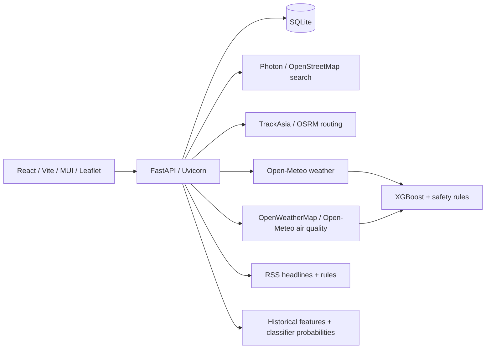

# Vietnam Travel Risk AI

**Đồ án môn Phát triển ứng dụng Web — Trường Đại học Công nghệ Thông tin, ĐHQG-HCM (UIT)**

Giảng viên: **Nguyễn Thanh Bình**. Thành viên, MSSV, lớp: bổ sung theo thông tin nhóm khi nộp bài.

[](https://github.com/Phuthanh123456/AI-based-risk-analysis-and-warning-system-for-tourism-web-project/actions/workflows/ci.yml)

Repository môn học: `Phuthanh123456/AI-based-risk-analysis-and-warning-system-for-tourism-web-project`.
Ứng dụng giúp du khách khám phá Việt Nam và cân nhắc chuyến đi qua **thời tiết/không khí, tuyến đường và tin tức địa phương**. Kết quả mang tính tham khảo, không phải xác nhận an toàn hay thông báo chính thức.

## Trạng thái triển khai

Đã có React frontend, REST API, SQLite, API docs, Docker và CI. Đợt kiểm tra **13/11/2026** chạy tại máy phát triển và Docker Linux, **chưa deploy bản cập nhật lên hosting**. Backend Railway trong cấu hình cũ trả HTTP 404. Frontend cũ trả HTML không chứng minh API hoạt động. Chưa có URL production mới được xác nhận cho bản này.

Khi nộp môn, cần bổ sung **Live URL, public API base URL và URL `/docs` online** sau triển khai; kiểm tra thêm slide và báo cáo Word. README không thay thế các tài liệu đó.

## Chức năng

| Nhóm | Hành vi hiện có |
| --- | --- |
| Khám phá | Danh mục 34 tỉnh/thành, đối chiếu địa phương cũ; điểm đến, văn hóa, ẩm thực và nhóm trải nghiệm |
| Tài khoản | Đăng ký, đăng nhập JWT, đăng xuất; SQLite lưu người dùng, lịch sử và đăng ký cảnh báo |
| Hành trình | Bắt buộc chọn xuất phát, đích có tọa độ, ngày đi và mục đích; gợi ý tìm địa chỉ, GPS |
| Ngày đi | Mặc định hôm nay theo giờ Việt Nam; chọn hôm nay và 7 ngày tiếp theo |
| Tổng quan | NÊN ĐI / CẦN LƯU Ý TRƯỚC KHI ĐI / KHÔNG NÊN ĐI; xét ba yếu tố, không tạo điểm tổng hợp giả |
| Thời tiết | Điểm 0–10 đúng ngày, dự báo từng ngày, PM2.5 khi nguồn có dữ liệu, gợi ý theo mục đích chuyến đi |
| Di chuyển | Bản đồ bên trái, thông tin bên phải; hình tuyến, quãng đường và thời gian ô tô ước tính; không chấm ùn tắc |
| Tin tức | Tối đa 12 tiêu đề trong mẫu 7 ngày; nguồn, mức lưu ý, tác động bất lợi/khắc phục/chưa rõ; xem bài gốc để xác minh |
| Tiện ích | So sánh tin điểm đến, lịch sử tra cứu, theo dõi thời tiết và kiểm tra cảnh báo |
| Giao diện | VI/EN, sáng/tối, desktop/mobile; giữ tên món ăn và thuật ngữ văn hóa đặc trưng khi cần |

Lịch sử lưu snapshot tại thời điểm gọi `/trip`, không phải kết quả dự báo tương lai đã kiểm chứng. Web Push cần HTTPS, VAPID, quyền người dùng và trình duyệt hỗ trợ. Hiện có nút kiểm tra cảnh báo; **chưa có scheduler tự động định kỳ**.

## Kiến trúc



Backend Python/FastAPI, frontend JavaScript/React 19; cơ sở dữ liệu SQLite, schema trong `src/api/db.py`. Môn học cho phép lựa chọn framework; API server này không dùng Node/Express. Mật khẩu băm bcrypt, token HS256 có thời hạn. `.env`, token và dữ liệu tài khoản không đưa vào Git.
Giữ nguyên dữ liệu/nhãn và tên tỉnh lịch sử trong `data/`; không tự gán nguồn hay giấy phép cho dữ liệu.

## AI và cách đánh giá thực tế

| Thành phần | Triển khai | Giới hạn |
| --- | --- | --- |
| Thời tiết | XGBClassifier 5 lớp, artifact `weather_risk_v5_classifier.pkl`, thứ tự feature từ `model_features.json`; safety gates cho cực đoan; điểm gốc 0–20 đổi thành 0–10 | Độ khớp nhãn không phải xác suất an toàn; điều chỉnh mục đích là quy tắc |
| Tin lịch sử | TF-IDF + Logistic Regression; xác suất đã tính trong `news_baseline_predictions.jsonl`, ghép article ID với feature/rule severity | Corpus hiện cũ, không dùng điểm lịch sử làm cảnh báo hiện tại |
| Tin RSS mới | Quy tắc tiêu đề, từ khóa, tuổi tin | Chưa chạy PhoBERT trên RSS mới; chưa xác minh toàn văn và sự cố thực tế |
| PhoBERT | Có pipeline và kết quả CPU smoke test | Chưa có checkpoint fine-tune đầy đủ được dùng trong runtime |
| Tuyến đường | Dịch vụ routing, hình tuyến và thời gian tham khảo | Không có model AI giao thông; không tự suy ra ùn tắc |
| Tổng quan | Quy tắc tổng hợp ba yếu tố, xét thiếu nguồn | Chưa train model tổng hợp ba yếu tố; không cộng/trung bình những thang đo khác bản chất |

Đánh giá lại artifact ngày 13/11/2026, **không train lại hoặc thay artifact**:

| Model | Tập đánh giá | Kết quả |
| --- | --- | --- |
| Thời tiết | 68.985 dòng năm 2025; train ban đầu 2023–2024, seed 42 | Balanced accuracy 0,9324; macro F1 0,9533 |
| Tin TF-IDF/LogReg | 542 bài validation loại trùng với 2.217 bài train; ngưỡng 0,5 | Precision/Recall/F1 0,9002; average precision 0,9558 |

Lớp thời tiết mức 4 chỉ có **19 mẫu validation, recall 0,6842**. Chưa có đánh giá thực địa chứng minh giảm sự cố. Chi tiết: [TRAINING.md](TRAINING.md), [ASSESSMENT.md](ASSESSMENT.md), [RELEASE_TEST_REPORT.md](RELEASE_TEST_REPORT.md).

## Cài đặt và chạy local

Khuyến nghị Python 3.11/3.12, Node 20.19+ hoặc 22.12+, npm và Git.

Dataset thời tiết và model v4 cũ đã dùng Git LFS từ trước. Cài Git LFS nếu cần lấy dataset để đánh giá/train; chạy `git lfs pull --include="src/integrations/weather/FINAL_DATASET_WITH_RISK-2.csv"`. Runtime dùng model v5 nhỏ, không cần tải model v4 hơn 100 MB. Không thêm lại file lớn thành Git blob thường.

```powershell
python -m venv .venv
.\.venv\Scripts\Activate.ps1
python -m pip install -r requirements.txt
Copy-Item .env.example .env
cd travel-ui
npm ci
cd ..
```

Điền cấu hình riêng trong `.env`. Trên Windows chạy **`START-WEB.cmd`**, hoặc:

```powershell
powershell.exe -NoProfile -ExecutionPolicy Bypass -File scripts/Start-Local.ps1 -NoBrowser
```

Frontend: **http://localhost:5180**. Backend: **http://127.0.0.1:8000**. Tắt máy sẽ dừng server local; chạy launcher lại sau khi bật máy. Log/khởi động lại: [RUNNING.md](RUNNING.md).

Chạy thủ công trong hai terminal:

```powershell
python -m uvicorn src.api.app:app --host 127.0.0.1 --port 8000
```

```powershell
cd travel-ui
npm run dev -- --host 127.0.0.1 --port 5180
```

## API docs

- Swagger UI: **http://127.0.0.1:8000/docs** — tham số, body, status, thử request.
- ReDoc: **http://127.0.0.1:8000/redoc**.
- OpenAPI JSON: **http://127.0.0.1:8000/openapi.json**.
- Endpoint, mẫu request, ý nghĩa kết quả: [API.md](API.md).

Đăng nhập qua `/api/auth/login`; gửi `Authorization: Bearer <token>` cho lịch sử/cảnh báo. `/trip` cho phép tra cứu công khai, token hợp lệ thì lưu lịch sử riêng. Không dùng tài khoản/key thật trong tài liệu công khai. `/health` kiểm tra tiến trình API, không chứng minh mọi nhà cung cấp dữ liệu đang đáp ứng.

## Kiểm thử

```powershell
python -m pytest -q
python -m scripts.evaluate_release_models --output model-evaluation.local.json
node scripts/audit-location-catalog.mjs
cd travel-ui
npm test
npm run lint
npm run build
```

Không cần commit output `.local.json`. GitHub CI chạy pytest, frontend tests, lint và build. Xem kết quả kiểm thử thật và giới hạn trong [RELEASE_TEST_REPORT.md](RELEASE_TEST_REPORT.md).

## Cấu hình production — chưa deploy

Tạo `.env` từ mẫu, đặt **JWT_SECRET riêng ngẫu nhiên ít nhất 32 byte**. Compose bật `APP_ENV=production`, từ chối secret mặc định/yếu.

```powershell
docker compose config --quiet
docker compose up -d --build
docker compose ps
```

Frontend: **http://localhost:5173**; backend: **http://localhost:8000**; Swagger qua nginx: **http://localhost:5173/docs**. Compose giữ `./data:/app/data`, có restart policy/healthcheck. Chưa phải public hosting/HTTPS. Server online cần domain, TLS, lưu trữ bền vững, backup SQLite và giám sát. Không chạy các bản API với SQLite tạm riêng lẻ rồi kỳ vọng tài khoản tự đồng bộ.

Nếu frontend ở Vercel riêng backend: root `travel-ui`, đặt **`VITE_API_BASE_URL=https://<backend-da-trien-khai>` trước build**, redeploy frontend. `vercel.json` chỉ giữ SPA rewrite, không trỏ cứng Railway cũ. Docs online nằm ở `<backend>/docs`; Docker nginx cũng proxy docs. `render.yaml` chỉ là mẫu; Render free không bảo đảm SQLite tồn tại sau redeploy.

Các nhà cung cấp có thể chậm, giới hạn hoặc gián đoạn; cache/deadline/retry không bảo đảm uptime tuyệt đối. Bản môn học dùng tile OSM/FOSSGIS; phục vụ tải lớn cần dịch vụ và điều kiện sử dụng phù hợp, không tải tile hàng loạt hoặc coi nguồn cộng đồng là SLA.

## Cấu trúc mã nguồn

```text
configs/                  Tỉnh, alias và ràng buộc vùng tìm kiếm
data/                     Dữ liệu, feature, prediction và artifact tin
src/api/                  REST API, auth, DB, thời tiết, tin, cảnh báo
src/integrations/          Kết nối nguồn thời tiết, địa điểm, routing
src/train/                Pipeline huấn luyện model
travel-ui/src/            React, catalogue, i18n
travel-ui/tests/          Kiểm thử logic frontend
tests/                    Kiểm thử backend
scripts/                  Launcher, audit danh mục, đánh giá artifact
.github/workflows/ci.yml  Kiểm thử tự động
```

Tài liệu: [I18N.md](I18N.md), [LOCATION_SEARCH.md](LOCATION_SEARCH.md), [PERFORMANCE.md](PERFORMANCE.md).
